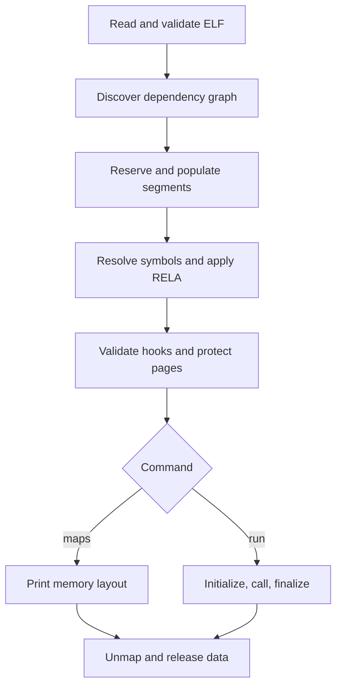

# Architecture and design decisions

ELFLab separates metadata parsing from memory mapping and execution. inspect, symbols, relocs, and deps do not call input code. maps proceeds through relocation and final permissions but skips initialization. run adds constructors, a function call, finalizers, and cleanup.

## Loading pipeline

## File view versus memory view

The file view is a malloc-owned byte snapshot. Metadata access is bounds-checked against the file and the appropriate PT_LOAD file-backed range. Header/symbol/relocation structures are copied with memcpy rather than dereferenced through potentially misaligned file pointers.

A file virtual address V within a segment translates to:

    file_offset = p_offset + (V - p_vaddr)

The loaded view occupies a contiguous anonymous mmap reservation. Let L be the lowest page-aligned PT_LOAD address and M be the mapping's host address:

    load_bias B = M - L
    runtime_address(V) = M + (V - L) = B + V

Memory access helpers verify that the requested bytes belong to a PT_LOAD interval, not merely to the enclosing reservation. Segment holes remain inaccessible.

Anonymous pages provide zero-filled memory for BSS. File-backed bytes are copied into the corresponding offsets. This is an eager-copy design; it does not provide demand paging or shared file-backed library pages.

## Dynamic metadata without section headers

The parser discovers PT_DYNAMIC from the program headers and follows DT_STRTAB, DT_SYMTAB, DT_RELA, DT_JMPREL, and related tags through virtual-to-file translation. The loader does not require section headers or their names.

SysV hash metadata supplies the dynamic symbol count through nchain. For GNU-only hash metadata, bounded buckets and the final terminated chain establish the upper symbol index. All names must terminate inside the string table.

Metadata arrays are retained separately from the loaded image. Relocating writable module memory cannot overwrite the host's relocation records while it iterates them.

## Dependency and symbol scope

The graph builder appends newly discovered DT_NEEDED objects while walking a queue. The resulting order is root, direct dependencies, then successive dependency levels. Canonical file paths deduplicate already loaded objects and stop graph cycles from loading indefinitely.

For externally visible global and weak definitions, the first matching symbol in this breadth-first scope wins. A root definition can therefore interpose on a dependency's default-visibility definition. Undefined weak references resolve to zero; undefined strong references fail linking.

Local, hidden, internal, and protected definitions referenced from their owning module bind there. Protected definitions remain externally visible. GNU UNIQUE and symbol versioning are outside this implementation.

The symbol lookup scans bounded tables linearly. Its cost can grow with both graph size and symbol count. A future performance extension could build a global name index or use the parsed hash tables for lookup.

## Relocation model

Each RELA entry specifies a write location, symbol index/type, and explicit signed addend. Symbol resolution produces S; load bias is B; the runtime write address is P; the addend is A.

| Type | Stored value | Width |
| --- | --- | --- |
| R_X86_64_NONE | No write | 0 |
| R_X86_64_RELATIVE | B + A | 64 bits |
| R_X86_64_64 | S + A | 64 bits |
| R_X86_64_GLOB_DAT | S | 64 bits |
| R_X86_64_JUMP_SLOT | S | 64 bits |
| R_X86_64_PC32 | S + A - P, checked signed range | 32 bits |
| R_X86_64_32 | S + A, checked unsigned range | 32 bits |
| R_X86_64_32S | S + A, checked signed range | 32 bits |

The implementation uses wide intermediate arithmetic for the 32-bit range checks. Eight-byte relocation arithmetic uses unsigned modulo-2^64 arithmetic. RELATIVE must reference symbol index zero.

JUMP_SLOT entries are bound eagerly before any module code runs. There is no resolver trampoline or lazy binding state. All writes must fit entirely within originally writable segment bytes. The project rejects text relocations instead of temporarily modifying executable segments.

## Memory protection and lifecycle

Occupied pages start readable/writable but non-executable while copying and relocating. Shared-page flags are combined, and a resulting writable/executable page is rejected. After all relocations, mprotect applies the final segment flags and removes write permission from the complete GNU_RELRO page range.

Constructor/finalizer addresses are checked against executable module ranges before initialization. Dependencies initialize first using a depth-first walk with visiting/done states. For dependency cycles, no total dependency-before-dependent ordering is possible; visiting edges are skipped and the resulting order is deterministic. Finalizers use the reverse of the actual initialization order.

The host and modules share the same process and stack. Module faults are not recovered. A module can also modify writable memory or perform syscalls after it starts. Bounds checks and W^X enforcement do not make this a security sandbox.

## Demonstration arithmetic

The base library supplies a multiply-by-three function, an assembly addition function, base_bias=7, and a zeroed BSS array. Its constructor sets base_ready=2.

The math library's constructor observes base_ready and sets math_ready=5. Its data pointer to a private seed exercises RELATIVE relocation; its function pointer to base_transform exercises a symbol-based 64-bit relocation. Imported globals and calls exercise GLOB_DAT and JUMP_SLOT.

For arguments 5 and 7:

    3*5 + 7 + base_bias(7) + math_offset(11) + seed(4) + math_ready(5) = 49

The override root changes base_bias to 19 and supplies optional_hook returning 100:

    3*5 + 7 + 19 + 11 + 4 + 5 + 100 = 161

## Verification boundaries

The C suite confirms actual kernel page flags through /proc/self/maps and checks the module's post-constructor/post-finalizer state. Python tests exercise CLI behavior, readelf agreement, malformed files, unsupported features, section-header independence, and cycle deduplication.

ASan and UBSan instrument the loader, not the freestanding guest modules. The successful development run disabled leak detection because the runtime could not access the required process metadata. Neither the tests nor the mutation smoke check establish full ABI compatibility or hostile-input safety.
